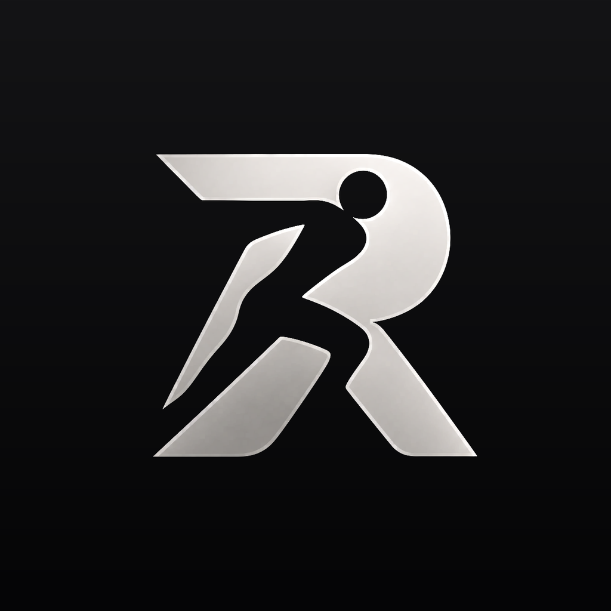

# RACK

**Workouts that adjust to you.** RACK tells you exactly what to lift today, counts your rest with a chime that plays over your music, and builds next week from how this week went.

- **Know what to do at a glance.** Every exercise reads like "3 x 10 at 45 lb", with the plates for each side.
- **A plan built around you.** Answer a few questions and RACK builds a plan for your goal, your days, and your equipment. Or use the ready-made RACK split, or build your own.
- **Gets smarter every week.** Rate how each exercise felt and RACK adjusts your weights, sets, and reps.
- **Right from your lock screen.** Log a set, add 30 seconds, skip, and see what's coming up next without unlocking.
- **Life happens.** Swap an exercise, skip a day and make it up later, or turn on Vacation mode.
- **Surprise me.** Pick the muscles, time, and gear (or nothing) and a shaker pours out a workout for today. Or skip the plan and go day by day.
- **Switch it up.** Kickboxing, boxing, calisthenics, yoga, pilates, HIIT, mobility, kettlebell, and dance, each with step-by-step how-tos and a guided session. Plus 200+ exercises, from deadlifts to your first pull-up.
- **Yours.** Pounds or kilograms, six rest chimes, sounds and haptics on or off. Your workouts stay on your phone: no account, no ads, free.

**Version 2.18.1** · Android 8 or newer · iPhone with iOS 17 or newer

---

## Install

Pick your phone. Each guide takes you from start to finish, one step at a time.

| Your phone | Download | Guide | Time |
|---|---|---|---|
| **Android** (8+) | [**RACK-2.18.1.apk**](https://github.com/TheShow715/rack-downloads/releases/download/v2.18.1/RACK-2.18.1.apk) | [Install on Android](#android) | 2 minutes, on the phone |
| **iPhone** (iOS 17+) | [**RACK-2.18.1.ipa**](https://github.com/TheShow715/rack-downloads/releases/download/v2.18.1/RACK-2.18.1.ipa) | [Install on iPhone](#iphone) | 15 minutes the first time, with a Windows PC or a Mac |

**Will it run on my phone?** [Check here](#which-phones). In short: any iPhone from the iPhone XS / XR (2018) on, and almost any Android phone from 2017 on.

Not sure which phone you have? If it says **iPhone** on the back or in **Settings → General → About**, it's an iPhone. Anything else (Samsung, Pixel, Motorola, OnePlus...) is Android.

---

## Android

You only need the phone. RACK isn't in the Play Store, so you download it here and Android asks you to allow it once.

**Step 1. Download RACK.** On the phone, open this page in **Chrome** and tap [**RACK-2.18.1.apk**](https://github.com/TheShow715/rack-downloads/releases/download/v2.18.1/RACK-2.18.1.apk).
If Chrome warns that the file could be harmful, tap **Download anyway**.

**Step 2. Open the file.** Tap **Open** when the download finishes.
Missed it? Open the **Files** app, go to **Downloads**, and tap **RACK-2.18.1.apk**.

**Step 3. Allow it, once.** Android says it isn't allowed to install apps from this source. Tap **Settings**, turn on **Allow from this source**, and tap back.

**Step 4. Tap Install.** If **Play Protect** says it doesn't know the app, tap **More details**, then **Install anyway**.

**Step 5. Open RACK.** Tap **Create a profile**, pick a username and password, and choose a plan. When it asks about notifications, tap **Allow**: that's where your rest timer and **Log set** button live.

That's it. 🎉

<b>Install from a computer instead (Windows or Mac)</b>

Use this if the phone can't download the file itself.

1. Download [**RACK-2.18.1.apk**](https://github.com/TheShow715/rack-downloads/releases/download/v2.18.1/RACK-2.18.1.apk) on the computer.
2. Connect the phone with a USB cable. On the phone, tap the **USB** notification and choose **File transfer**.
   - **Windows:** the phone shows up in File Explorer.
   - **Mac:** install the free **OpenMTP** app (openmtp.ganeshrvel.com) to see the phone's files.
3. Copy **RACK-2.18.1.apk** into the phone's **Download** folder.
4. On the phone, open **Files → Downloads**, tap the file, and continue from **Step 3** above.

Already use **adb**? Turn on USB debugging and run `adb install -r RACK-2.18.1.apk`.

**Updating:** download the newest .apk from this page, open it, and tap **Update**. Your workouts stay. Never uninstall RACK to update: that deletes its data.

**Rest chime late with the phone locked?** Open the phone's **Settings → Apps → RACK → Battery** and choose **Unrestricted**. On Samsung, also take RACK out of **Sleeping apps**.

---

## iPhone

RACK isn't in the App Store, so you put it on your iPhone with a free computer app called **Sideloadly**. You need:

- A **Windows PC** or a **Mac**
- Your iPhone and a **USB cable** that carries data (the one from the box works)
- Your **Apple ID** email and password (a free Apple ID is fine)

### Step 1. Set up the computer (first time only)

**On a Windows PC:**
1. Install **iTunes** from apple.com/itunes/download/win64. If you have iTunes from the Microsoft Store, uninstall it first: the Store version doesn't work.
2. Install **iCloud** using the iCloud link on sideloadly.io.
3. Install **Sideloadly** from **sideloadly.io** (only from there).
4. Restart the PC.

**On a Mac:**
1. Install **Sideloadly for macOS** from **sideloadly.io** (only from there). Drag it to Applications.
2. Open it. If the Mac says it's from an unidentified developer, open **System Settings → Privacy & Security** and click **Open Anyway**.

### Step 2. Put RACK on the iPhone

1. Download [**RACK-2.18.1.ipa**](https://github.com/TheShow715/rack-downloads/releases/download/v2.18.1/RACK-2.18.1.ipa) on the computer. Don't unzip or rename it.
2. Unlock the iPhone and plug it in. Tap **Trust** on the iPhone and enter your passcode.
3. Open **Sideloadly**. Your iPhone's name shows in the **iDevice** box.
4. Drag **RACK-2.18.1.ipa** onto the **IPA** icon in Sideloadly.
5. Type your **Apple ID** email in the **Apple account** box and click **Start**.
6. Enter your Apple ID password (it only goes to Apple) and the 6-digit code if one appears.
7. Wait for **Done**. The RACK icon appears on the iPhone.

### Step 3. Open RACK (first time only)

1. On the iPhone, open **Settings → General → VPN & Device Management**, tap your email under **Developer App**, and tap **Trust**.
2. Tap the RACK icon, then tap **OK** on the Developer Mode message. Open **Settings → Privacy & Security → Developer Mode**, turn it **On**, and tap **Restart**. After the restart, tap **Turn On**.
3. Open RACK, tap **Create a profile**, and choose a plan. Tap **Allow** for notifications and Live Activities.

That's it. 🎉

### Every 7 days

A free Apple ID lets the app run for 7 days. To keep it going, plug in the iPhone and repeat **Step 2** with the same Apple ID. Your workouts stay. A weekly reminder helps.

**Updating:** same as above: download the newest .ipa from this page and repeat **Step 2**. Never delete RACK to update: that deletes your workouts.

<b>Using AltStore instead of Sideloadly (Mac or Windows)</b>

1. Install **AltServer** from **altstore.io** and follow its steps to put **AltStore** on the iPhone.
2. Download **RACK-2.18.1.ipa** on the iPhone (or AirDrop it from the Mac).
3. In AltStore, go to **My Apps**, tap **+**, and pick the file.
4. AltStore refreshes RACK every 7 days by itself when the iPhone and computer are on the same Wi-Fi.

<b>iPhone help</b>

- **The iPhone doesn't show in Sideloadly:** unlock it, tap **Trust**, try another cable or port. On Windows, make sure iTunes is the website version.
- **RACK opens and closes right away:** the 7 days ran out. Repeat Step 2; your data is still there.
- **"Untrusted Developer":** do Step 3, item 1 again with the iPhone online.
- **Sideloadly says you've reached the app limit:** a free Apple ID can have 3 apps like this. Remove another one (never RACK).
- **No workout on the Lock Screen:** **Settings → RACK → Live Activities** → on.

---

## Which phones

**iPhone: iOS 17 or later.** That's the iPhone XS, XS Max, XR, and every iPhone since, including the iPhone SE (2nd and 3rd generation). To check: **Settings → General → About → iOS Version**. If it's below 17, update it in **Settings → General → Software Update** first.

| Your iPhone's iOS | What you get |
|---|---|
| **iOS 26 or later** | Everything, with the new glass look. "Chime twice" also sets a system alarm as a backup in case iOS closes RACK. |
| **iOS 17 or 18** | Everything else: workouts, plans, the rest chime over your music, the Lock Screen workout with its buttons, and backups. The Dynamic Island shows on iPhone 14 Pro and later. |
| **iOS 16 or earlier** | RACK won't install. Update the iPhone if it can; the iPhone 8 and X stop at iOS 16. |

**Android: version 8 (Oreo) or later.** To check: **Settings → About phone → Android version** (on Samsung, **Software information**). Everything works the same on every version. On Android 13 and later, RACK asks to show notifications: tap **Allow** so the rest timer and **Log set** show on the lock screen.

---

## Keep your workouts safe

RACK saves a backup every day and before every update. To move to a new phone (iPhone or Android, either way), go to **Settings → Export backup** on the old phone, then **Settings → Import backup** on the new one. Importing never deletes anything.

---

## What's new in 2.18.1

**Fixed**
- Surprise me has a real flip-top shaker: the drink sloshes while it shakes, the lid flips open, it pours from the spout, and the drink floods the screen to show your workout.

[Every version](https://github.com/TheShow715/rack-downloads/releases)
